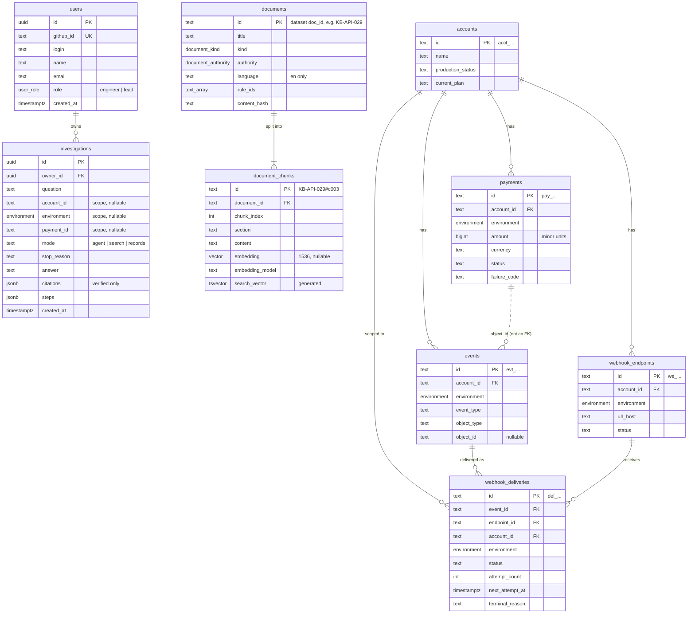

# Database

PostgreSQL 17 with the `vector` extension (pgvector), managed by Drizzle ORM. The schema lives in [`src/lib/db/schema.ts`](../src/lib/db/schema.ts); SQL migrations are in [`drizzle/`](../drizzle):

| Migration | Adds |
|---|---|
| `0000_enable_pgvector` | `vector` extension |
| `0001_create_users` | `users`, `user_role` |
| `0002_create_documents` | `documents`, `document_chunks` (vector + generated tsvector) |
| `0003_create_business_records` | `accounts`, `webhook_endpoints`, `payments`, `events`, `webhook_deliveries`, `environment` |
| `0004_create_investigations` | `investigations` |

Migrations run in CI (integration and E2E setup) and on every Vercel deployment (`npm run vercel-build`).

## Entity-relationship diagram

## Design notes
- **Real identifiers as primary keys.** Documents and business records keep the dataset's own IDs (`KB-API-029`, `pay_bg_001_0003`), so citations shown to users are exactly what is stored. They are never generated.
- **Scope on every business row.** `payments`, `events`, `webhook_endpoints` and `webhook_deliveries` all carry `account_id` and `environment`. Deliveries copy them from their event at import time, so every query filters on scope without joins. The importer skips a delivery whose event and endpoint disagree on scope.
- **Indexes that match the queries:**
  - `(account_id, environment)` on business tables; `(account_id, environment, object_id)` on events.
  - HNSW (cosine) on `document_chunks.embedding`; GIN on `search_vector`.
  - `(owner_id, created_at, id)` and `(created_at, id)` on investigations, for history pagination.
- **Integrity.** Foreign keys with `ON DELETE CASCADE`, enums for kinds, authorities, environments and roles, and a unique `(document_id, chunk_index)`.
- **Not imported.** The dataset's `customers` (emails), `event_journal` (audit journal) and benchmark answers are never loaded.
- **Hybrid search columns.** `search_vector` is generated by PostgreSQL: section weighted `A`, content `B`, English configuration. `embedding` is nullable, so keyword search works before embeddings exist.
